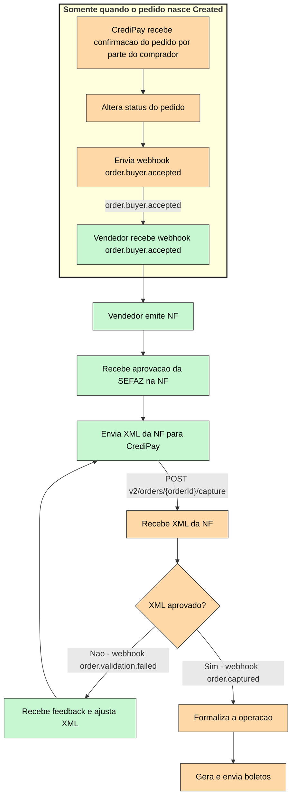

# Introdução

O pedido precisa estar confirmado antes de você enviar a Nota Fiscal. A confirmação acontece de um de dois jeitos, conforme a configuração comercial do vendedor com a CrediPay. Em geral, ela é automática no e-commerce e feita pelo comprador em televendas (veja [Canais de vendas](doc:canais-de-vendas)).

Para saber qual vale para um pedido, leia o campo `status` na resposta do `POST /v2/orders`:

| `status` na resposta | O que acontece | O que você faz |
| :-- | :-- | :-- |
| `Accepted` ou `WaitingForInvoice` | O pedido já está confirmado. A CrediPay não envia e-mail ao comprador. | Emita e envie a NF. |
| `Created` | A CrediPay envia um e-mail com o link de confirmação para o contato informado no pedido e para o contato cadastrado do comprador. Quando o comprador confirma, o pedido muda de status e você recebe o webhook `order.buyer.accepted`. | Espere o webhook. Depois, emita e envie a NF. |

Sendo feito isso, a Nota Fiscal deve ser emitida e enviada em seguida (não é possível enviar uma NF antes que o pedido seja confirmado). A CrediPay somente formalizará e se comprometerá com a transação uma vez que a NF seja aceita. Para mais informações sobre os critérios de aceite, acesse [POST v2/orders/`{orderId}`.](https://docs.credipay.credix.finance/reference/post-capture-order)

Quando o XML de uma NF for aceito, os boletos serão emitidos automaticamente e enviados ao comprador. Para o integrador, pode ser interessante receber esses arquivos também. Para isso, cheque [Recebimento de boletos](doc:receber-boletos)

# Fluxo

**Legenda:**

* :green_square: Verde: Ações tomadas pelo vendedor
* :orange_square: Laranja: Ações tomadas pela CrediPay

 

